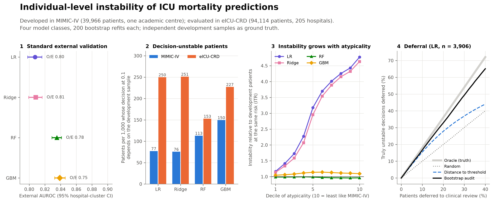

# cpmaudit

**Would the same patient get the same decision if the model had been built on a different sample? `cpmaudit` audits how much each individual's predicted risk, and the decision based on it, depends on the luck of the data a clinical risk model was built on, before the model is used on patients.**

[](https://pypi.org/project/cpmaudit/)
[](https://pypi.org/project/cpmaudit/)
[](https://github.com/Krutarth007/cpmaudit/blob/main/LICENSE)
<!-- After the first Zenodo release, add the DOI badge here:
[](https://doi.org/10.5281/zenodo.XXXXXXX) -->

```bash
pip install "cpmaudit[all]"
cpmaudit demo --out-dir demo_out      # synthetic example, writes demo_out/report.html in under a minute
```

This repository contains two things:

1. **The `cpmaudit` Python package** (`src/`, `tests/`, `docs/`): a general tool for any binary-outcome risk model and any tabular data.
2. **A fully reproducible study** (`study/`): ICU mortality models developed in MIMIC-IV and moved to 205 hospitals in eICU-CRD, with every published table and figure, their SHA-256 provenance records, and a one-command check that they are unchanged.



---

## Contents

- [Why this matters](#why-this-matters)
- [What we found in 205 hospitals](#what-we-found-in-205-hospitals)
- [Installation](#installation)
- [Quick start](#quick-start)
- [What cpmaudit measures](#what-cpmaudit-measures)
- [Governance: turn an audit into a decision](#governance-turn-an-audit-into-a-decision)
- [Reproduce the study](#reproduce-the-study)
- [Repository layout](#repository-layout)
- [Citing](#citing)
- [Methods and references](#methods-and-references)
- [Contributing, licence and acknowledgements](#contributing-licence-and-acknowledgements)

---

## Why this matters

A risk model developed on 4,000 patients is one of many models that *could* have been developed from 4,000 patients of the same population. Two equally defensible versions can give the same patient risks of 8% and 12%. Under a rule that flags risks above 10% for senior review, the patient is flagged by one model and not by the other, although nothing about the patient has changed.

Discrimination (AUROC) and calibration are population averages and cannot show this. Reporting and appraisal guidance for prediction models (TRIPOD+AI, PROBAST+AI) and recent methodological work therefore ask developers to quantify the instability of individual predictions. `cpmaudit` makes that a routine, reproducible step: it repeats your **entire** model-building process on hundreds of resamples of the development data and reports, patient by patient, how far the predicted risk moves, how often the decision flips, whether the instability grows in another population, and whether the model passes limits you agree in advance.

## What we found in 205 hospitals

We developed four model classes for in-hospital mortality at 24 hours after ICU admission on **39,966 MIMIC-IV patients** (one academic centre) and evaluated them on **94,114 eICU-CRD patients in 205 US hospitals**. Every model was refitted 200 times.

| | Logistic regression | Ridge regression | Random forest | Gradient boosting |
|---|---|---|---|---|
| External AUROC (95% CI) | 0.807 (0.798 to 0.816) | 0.808 (0.799 to 0.817) | 0.835 (0.829 to 0.841) | 0.839 (0.832 to 0.846) |
| Observed/expected deaths | 0.80 | 0.81 | 0.78 | 0.75 |
| Decision-unstable patients per 1,000 at a 0.10 threshold, development → external | 77 → 250 | 76 → 251 | 113 → 153 | 150 → 227 |
| Instability transport ratio (95% CI) | 3.04 (2.75 to 3.34) | 2.93 (2.68 to 3.18) | 0.98 (0.97 to 0.98) | 1.10 (1.09 to 1.12) |

- **Population metrics looked acceptable while individual decisions became far less reproducible.** For logistic regression, one external patient in four received a decision that depended on which sample the model happened to be built from.
- **Calibration checks did not detect it.** 40 of the 45 hospitals with acceptable calibration (observed/expected 0.8 to 1.25) had excess decision instability.
- **The cause was measurement practice.** Missingness indicators learned where a test is almost always recorded amplified instability for patients whose pattern of missing measurements was rare (transport ratio 4.26) or never seen (4.98) in the development data. These patients made up 47% of the external cohort. Refitting without indicators reduced the ratio from 3.16 to 1.13 (100 refits each).
- **The audit helps, within limits.** Deferring patients flagged by the bootstrap audit captured 67% of truly unstable decisions, against 47% when deferring patients closest to the threshold. For the regression models it underestimated true external instability (audited/true 0.49 to 0.67), so it should be paired with a check of how well the development data cover the deployment site's measurement patterns.

The *instability transport ratio* compares each external patient's instability with that of development patients at the same predicted risk (1 = unchanged, 2 = doubled). It is computed in `study/03_external_multiplicity_governance_v4.ipynb`; full results, ground-truth checks against independent development samples, a simulation study and sensitivity analyses are in [`study/`](study/).

## Installation

```bash
pip install cpmaudit                 # core: numpy, pandas, scipy, scikit-learn, joblib
pip install "cpmaudit[plot]"         # + matplotlib figures and HTML reports
pip install "cpmaudit[data]"         # + DuckDB/pyarrow for large CSV/Parquet tables
pip install "cpmaudit[all]"          # everything above (+ statsmodels for loess calibration)
```

From a clone of this repository:

```bash
pip install -e ".[all,dev]"
pytest
```

Python 3.9 or newer. The core needs only the scientific Python stack, so it runs on older CPUs and modest laptops.

## Quick start

```python
from cpmaudit import StabilityAudit
from cpmaudit.datasets import make_clinical_risk_data, FEATURES

data = make_clinical_risk_data(n_stays=6000, random_state=1)     # synthetic, multi-site
dev, ext = data[data.site_id <= 3], data[data.site_id > 3]

audit = StabilityAudit(
    model="logistic",            # or any scikit-learn pipeline / callable
    n_bootstrap=200,
    bootstrap="cluster",         # resample patients, not rows
    thresholds=(0.1, 0.2),       # decision thresholds that matter clinically
    random_state=2024,
    n_jobs=-1,
)
result = audit.run(
    dev[FEATURES], dev["outcome"],
    groups=dev["patient_id"],                               # cluster labels for the bootstrap
    subgroups=dev["sex"],                                   # optional subgroup summaries
    X_external=ext[FEATURES], y_external=ext["outcome"],    # optional external population
)

result.summary()                     # key measures, development and external
result.individual()                  # one row per patient: risk, interval, MAPE, decision flips per threshold
result.optimism()                    # optimism-corrected, out-of-bag, .632 and .632+ performance
result.export("audit_output")        # CSV + JSON + a self-contained report.html
```

**Three rules for valid results with your own data**

1. **Pass the whole model-building process as the model.** Imputation, scaling, variable selection and tuning must happen *inside* the pipeline or callable, because their instability is part of what is measured.
2. **Resample the right unit.** If a patient contributes several rows, use `bootstrap="cluster"` with `groups=<patient id>`.
3. **Use the thresholds at which decisions are actually made.**

Model presets (`"logistic"`, `"logistic_l2"`, `"logistic_l1"`, `"random_forest"`, `"hist_gradient_boosting"`, `"lightgbm"`, `"xgboost"`), any scikit-learn estimator (tuning is repeated in every replicate) or any callable that returns a fitted model are accepted. See [`examples/quickstart.py`](examples/quickstart.py) and [`docs/methods.md`](docs/methods.md).

## What cpmaudit measures

| Question | Output |
|---|---|
| How much does *each individual's* risk move? | Mean absolute prediction error (MAPE), percentile interval, SD and largest change per individual (`individual`) |
| How often does each individual's decision flip? | Classification instability index at each threshold, share of flip-prone individuals, expected number of changed decisions |
| Is the overall risk, the risk distribution and subgroup risk stable? | Riley and Collins levels 1 to 3 (`summary`, `distribution_stability`, `subgroup_summary`) |
| Does instability carry over to another hospital or database? | Every replicate model is applied to the external population; instability and the spread of external AUROC, calibration and net benefit are reported |
| Is apparent performance optimistic? | Harrell bootstrap optimism, out-of-bag, .632 and .632+ estimates from the same replicates |
| Are calibration and clinical utility stable? | Calibration curves and decision curves for every replicate model |
| Do equally good models disagree? | Rashomon set, ambiguity, discrepancy, pairwise disagreement, viable prediction range (`MultiplicityAudit`) |
| How many patients are needed? | Analytic minimum sample size (`minimum_sample_size_binary`) and empirical instability-versus-size curves (`instability_curve`) |
| Is the model acceptable under our rules? | Pre-agreed limits checked automatically, with a pass/fail table and a CI-friendly exit code (`StabilityPolicy`) |

Large databases (MIMIC-IV, MIMIC-III, eICU-CRD, OMOP CDM, MEDS) can be read in any folder layout, with column and row filters, through `cpmaudit.io.TableStore`.

## Governance: turn an audit into a decision

```python
from cpmaudit import StabilityPolicy, model_facts

report = StabilityPolicy().evaluate(result)        # pre-agreed limits, development and external
print(report)                                      # pass/fail table
report.raise_if_failed()                           # stop a deployment pipeline if limits are not met

defer = result.flag_unstable("external", max_cii=0.10)    # patients to route to clinical review
facts = model_facts(result)                        # stability fields for a model card or facts label
```

Typical uses: pre-deployment review by AI oversight committees, checking a model imported from another hospital on local patients, selective deferral of unstable predictions to clinicians, threshold choice, vendor evaluation with local data, and model-risk documentation in regulated settings.

From the command line:

```bash
cpmaudit stability --data cohort.parquet --outcome died --group-col subject_id --bootstrap cluster \
    --model logistic --bootstraps 500 --threshold 0.1 0.3 --external other_site.parquet \
    --subgroup-col sex --n-jobs -1 --out-dir audit --policy
cpmaudit sampsize --parameters 30 --prevalence 0.12 --cstatistic 0.80
```

## Reproduce the study

The study uses two credentialed-access databases from PhysioNet, which cannot be redistributed. This repository contains the analysis code and all aggregate results, but **no patient-level data**.

1. Obtain access to [MIMIC-IV v2.2](https://doi.org/10.13026/6mm1-ek67) and [eICU-CRD v2.0](https://doi.org/10.13026/C2WM1R): complete the required training and sign each data use agreement on PhysioNet.
2. Create the environment: `pip install -r requirements.txt` (the exact versions used for the published run, Python 3.11).
3. Point the notebooks at your local copies with `STUDY_MIMIC_ROOTS` and `STUDY_EICU_ROOTS`.
4. Run the three notebooks in `study/` in order. A `quick` preset checks the set-up in minutes; the default `full` preset is the pre-specified analysis.
5. Check that the published outputs are unchanged: `python study/verify_outputs.py`.

Step-by-step instructions, run times, configuration options and a description of every output are in [`study/README.md`](study/README.md).

## Repository layout

```
cpmaudit/
├── src/cpmaudit/          the package (stability, multiplicity, sample size, governance, io, plotting, CLI)
├── tests/                 unit tests (run on Linux, Windows and macOS, Python 3.9 to 3.13)
├── docs/methods.md        methods, formulas and references
├── examples/              runnable example on synthetic data
├── study/                 the reproducible ICU study
│   ├── 01_cohorts_features_quality_v2.ipynb
│   ├── 02_development_instability_v2.ipynb
│   ├── 03_external_multiplicity_governance_v4.ipynb
│   ├── outputs/           all tables (CSV/JSON), figures (PNG 300 dpi + vector PDF) and provenance logs
│   ├── verify_outputs.py  checks every output against its SHA-256 provenance record
│   └── README.md          how to reproduce the study
├── requirements.txt       exact environment of the published run
├── pyproject.toml         package metadata
└── CITATION.cff           citation metadata ("Cite this repository" on GitHub)
```

## Citing

If you use `cpmaudit` or build on this study, please cite the software. GitHub's **"Cite this repository"** button (from [`CITATION.cff`](CITATION.cff)) gives APA and BibTeX formats:

```bibtex
@software{patel_cpmaudit_2026,
  author  = {Patel, Krutarth},
  title   = {cpmaudit: auditing the instability of individual predictions from clinical risk models},
  year    = {2026},
  version = {0.1.0},
  url     = {https://github.com/Krutarth007/cpmaudit}
}
```

A paper describing this study will be linked here when it is available. Please also cite the methodological work the audit builds on (below) and the PhysioNet databases if you use the study code.

## Methods and references

The audit follows and extends:

- Riley RD, Collins GS. Stability of clinical prediction models developed using statistical or machine learning methods. *Biometrical Journal* 2023;65:e2200302. https://doi.org/10.1002/bimj.202200302
- Riley RD, Pate A, Dhiman P, et al. Clinical prediction models and the multiverse of madness. *BMC Medicine* 2023;21:502. https://doi.org/10.1186/s12916-023-03212-y
- Riley RD, Collins GS, Kirton L, et al. Uncertainty of risk estimates from clinical prediction models: rationale, challenges, and approaches. *BMJ* 2025;388:e080749. https://doi.org/10.1136/bmj-2024-080749
- Thomassen D, le Cessie S, van Houwelingen HC, Steyerberg EW. Effective sample size: a measure of individual uncertainty in predictions. *Statistics in Medicine* 2024;43:1384–1396. https://doi.org/10.1002/sim.10018
- Marx C, Calmon F, Ustun B. Predictive multiplicity in classification. *ICML* 2020, PMLR 119:6765–6774.
- Riley RD, Ensor J, Snell KIE, et al. Calculating the sample size required for developing a clinical prediction model. *BMJ* 2020;368:m441. https://doi.org/10.1136/bmj.m441

Data used in the study:

- Johnson AEW, Bulgarelli L, Shen L, et al. MIMIC-IV, a freely accessible electronic health record dataset. *Scientific Data* 2023;10:1. https://doi.org/10.1038/s41597-022-01899-x
- Pollard TJ, Johnson AEW, Raffa JD, et al. The eICU Collaborative Research Database, a freely available multi-center database for critical care research. *Scientific Data* 2018;5:180178. https://doi.org/10.1038/sdata.2018.178

Formulas, defaults and further references: [`docs/methods.md`](docs/methods.md).

## Contributing, licence and acknowledgements

Bug reports, feature requests and pull requests are welcome; see [`CONTRIBUTING.md`](CONTRIBUTING.md). Never commit patient data, even small extracts; use `cpmaudit.datasets.make_clinical_risk_data` for examples and tests.

**Licence:** MIT ([`LICENSE`](LICENSE)). The MIMIC-IV and eICU-CRD data remain subject to their PhysioNet licences and data use agreements.

**Study authors:** Krutarth Patel, Darshit Vora, Vaishnavi Gadve, Naveen Nirmal, Phanindra Beedala, Harshil Mehta. **Package author and maintainer:** Krutarth Patel ([ORCID 0009-0002-8748-8098](https://orcid.org/0009-0002-8748-8098)).

**Acknowledgements:** the MIT Laboratory for Computational Physiology, Beth Israel Deaconess Medical Center and the Philips eICU Research Institute for making the data available through PhysioNet.

**Disclaimer:** `cpmaudit` is research software. It is not a medical device, and the models in `study/` were built to study instability, not for clinical use.
